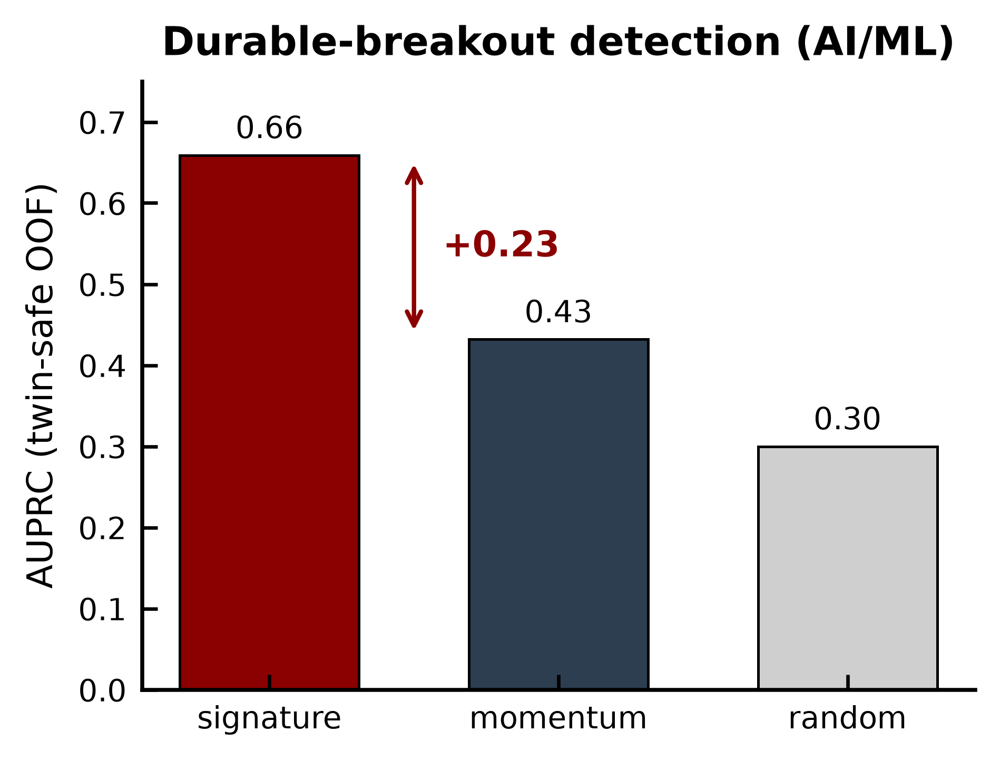
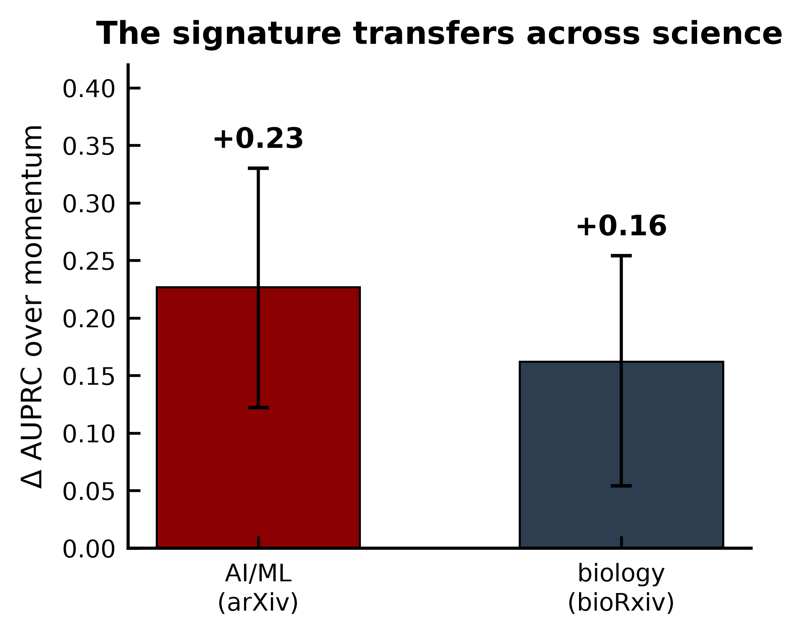
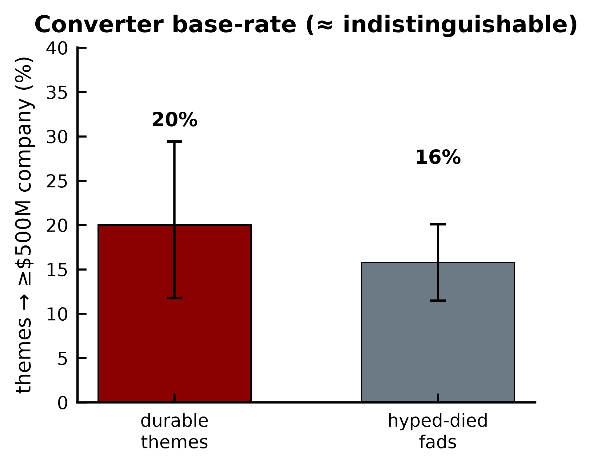

# halflife-research

## How it's used at Vela

Halflife research matured at vela and became Market Breakout. The tool is accessible at: https://breakout.vela.partners/

**Most research ideas decay. Some compound. This tells you which, early, and who is behind them.**

Built during my research internship at Vela Partners (2026). Vela now runs an extended version of
it in house as a monthly research-trends product.

| | |
| --- | --- |
| **+0.23 AUPRC** over momentum | durable vs fad on 383 AI/ML research themes, 95% CI [+0.12, +0.33], p < 0.001 |
| **6 / 6** | pre-registered cross-field predictions correct |
| **+0.16, p = 0.002** | transfers unchanged to biology (263k bioRxiv preprints) |
| **Momentum subsumed** | adding momentum to the model adds nothing |
| **0 look-ahead** | every datum carries the date it became public; a leakage test gates every build |

---

## What it does

Every hype cycle produces hundreds of "next big things". Most fade within two years. A few, like
transformers or GRPO, become the foundation of a field and of the companies built on it. The usual
way to tell them apart is **momentum**: how fast something is growing. But a durable idea and a
spike look the same in their first months.

halflife-research reads a new idea's first months on arXiv and predicts whether it will still be
growing two years later. The pipeline:

1. **Collects** papers and eight other alternative-data sources, storing each record with the date
   it became public.
2. **Detects** new research themes as they emerge, month by month.
3. **Measures** each theme as it looked at the time: how persistently it appears, how many
   independent groups adopt it, how fast it grows, how widely it spreads.
4. **Predicts** durable vs fad, and reports the theme's current trajectory (accelerating, sustained,
   cooling or faded) and the researchers driving it.

```
sources (9) --> point-in-time store --> themes --> as-of features --> detector --> radar
                (reference_date +       (emergence   (signature +      (gradient    (live ideas,
                 knowledge_date)         detection)   author)            boosting /   trajectory,
                                                                         logistic)    people)
```

## Quant methodology

The project applies quant-finance backtesting discipline to research and alternative data. Every
item below is enforced in code, not just described.

| Technique | What it guards against | In the code |
| --- | --- | --- |
| **Point-in-time data** (the ALFRED / real-time data approach) | Look-ahead bias. Every record has a `reference_date` (what it's about) and a `knowledge_date` (when it became public); a month-T query sees nothing published after T | [`marketbrain/schema/bitemporal.py`](marketbrain/schema/bitemporal.py), [`marketbrain/corpus/asof.py`](marketbrain/corpus/asof.py) |
| **Leakage canary** | A future value slipping into a feature. `check_no_future_leakage` runs on every panel build and fails it on any violation | [`marketbrain/validation/checks.py`](marketbrain/validation/checks.py), [`tests/test_leakage.py`](tests/test_leakage.py) |
| **Survivorship-free universes** | Overstating the past by sampling only winners. Failed markets and dead ideas stay in every month's universe | [`marketbrain/validation/checks.py`](marketbrain/validation/checks.py) |
| **Look-ahead leak hunting** | Leaks hiding in "static" fields. Found that arXiv venue and institution fields are backfilled after acceptance, and removed them | [`experiments/venue_sensitivity.py`](experiments/venue_sensitivity.py), [`experiments/verify_leak.py`](experiments/verify_leak.py) |
| **Pre-registration** | Tuning to the answer. Hypotheses, thresholds and all six field predictions were fixed before scoring | [`experiments/eval_preregister.py`](experiments/eval_preregister.py) |
| **Placebo and permutation tests** | Lift from a bug or from sector/year composition. Label-shuffle placebos and stratified permutation nulls | [`experiments/verify_placebo.py`](experiments/verify_placebo.py) |
| **Grouped, held-out evaluation** | Near-duplicate themes leaking across folds. Twin-grouped cross-validation with paired bootstrap confidence intervals | [`experiments/phase1_secure.py`](experiments/phase1_secure.py) |
| **Lead-lag analysis** | Mistaking a follower for a leader. Cross-correlation across signals and funding | [`experiments/lagged_correlation.py`](experiments/lagged_correlation.py), [`experiments/cross_corr_smoke.py`](experiments/cross_corr_smoke.py) |
| **Robustness sweeps** | A result that only exists at one setting. 400-combination corpus ablation, label-gate and horizon sweeps | [`experiments/corpus_ablation.py`](experiments/corpus_ablation.py), [`experiments/emergence_gate_sweep.py`](experiments/emergence_gate_sweep.py) |

## Results

**Durable ideas look different early, and it isn't how fast they grow.** It's how they grow:

- **Persistence.** The idea keeps appearing month after month instead of spiking.
- **Author breadth.** Many independent groups adopt it early, not one lab.

Fads grow fast, from few hands, in bursts. On held-out, twin-grouped evaluation the signature beats
momentum by **+0.23 AUPRC** and contains everything momentum measures.

<p align="center">
  
  
</p>

**It isn't specific to AI.** I pre-registered which of six fields should show the effect before
scoring any of them. It fires where research moves through discrete method breakouts (AI/ML +0.23,
biology +0.16, signal processing +0.13) and correctly stays silent in quantum physics, high-energy
theory and gravitation. Six fields, six correct calls.

## Does it predict capital? Tested properly

The obvious next question: **does durable research predict where money goes?** I tested it the way
a quant desk tests a signal: point-in-time, pre-registered, survivorship-free, with lead-lag analysis
and placebo controls, across nine sources (arXiv, GitHub, PyPI, npm, SEC EDGAR, patents,
Crunchbase, Hacker News, Wikipedia).

**The result was a clean null at market level.** Research attention follows funding rather than
leading it. Durable ideas produce a $500M+ company 20% of the time, against 16% for fads, and the
confidence intervals overlap.

<p align="center">
  
</p>

Every test is written up in [`docs/what_didnt_work.md`](docs/what_didnt_work.md). The takeaway: the
edge isn't in predicting markets from research volume. It's in identifying **which ideas, and which
people, will last**.

## Stack

Python, pandas, scikit-learn, gradient boosting, parquet, the Gemini Batch API, OpenAlex, and the
arXiv / bioRxiv APIs. Frontend: Next.js, TypeScript, Tailwind, FastAPI.

Raw data isn't included. arXiv, bioRxiv and OpenAlex are public and the fetchers are in
`experiments/`. Crunchbase and other licensed sources are not redistributable.

---
